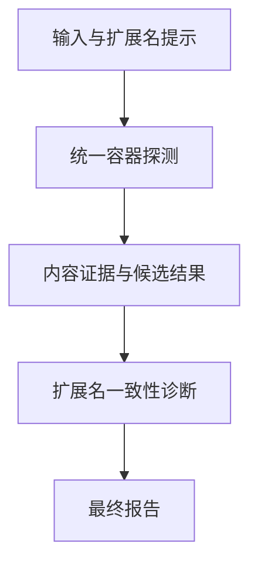
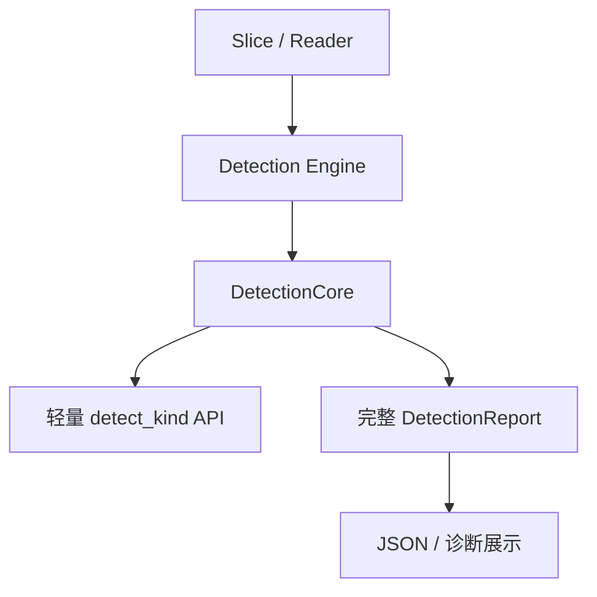
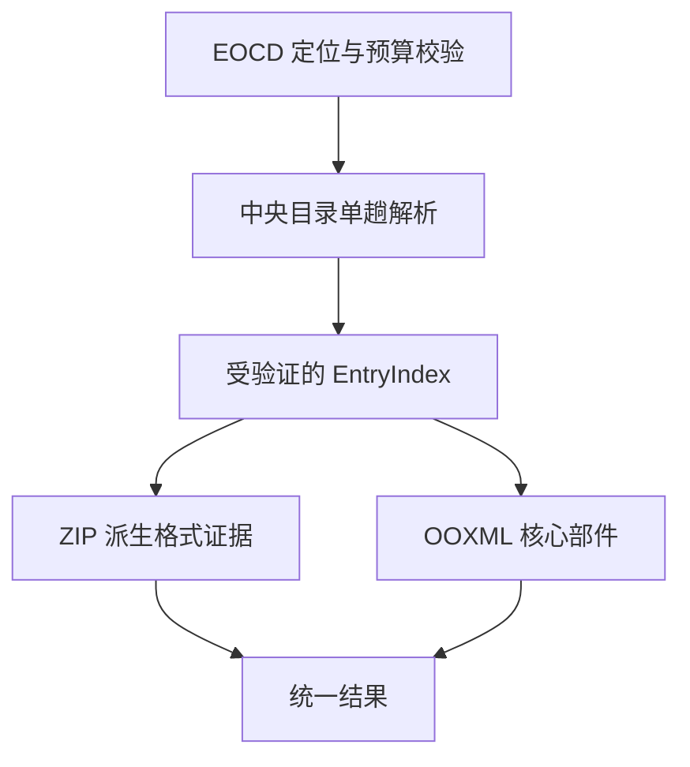
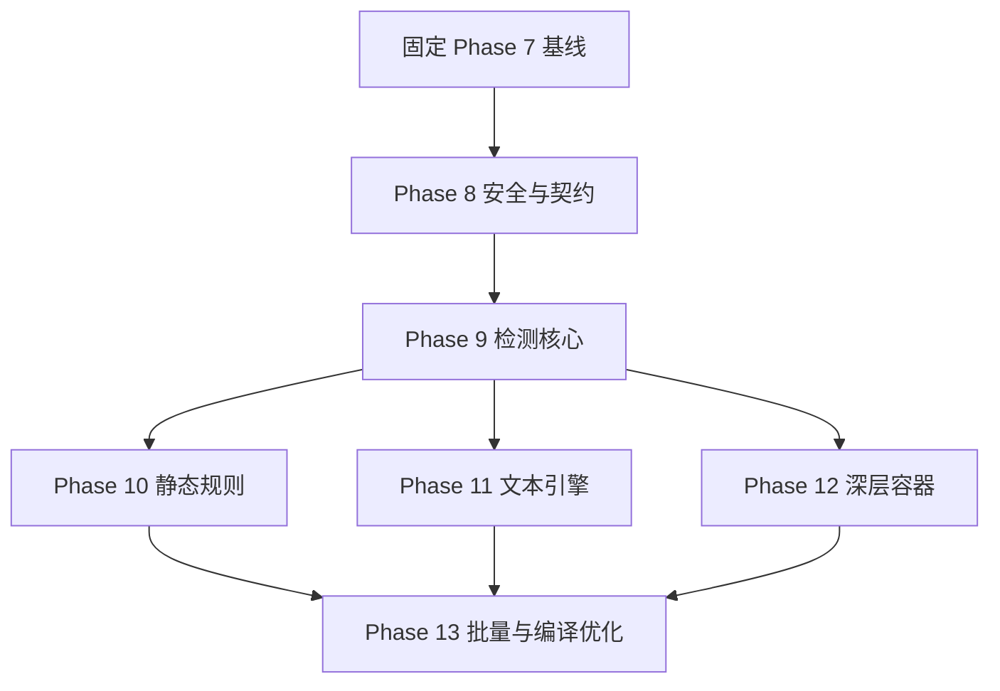

# KindProbe 深度架构审查与后续优化路线图

> **定位**：面向项目维护者、Rust 性能工程师及架构师的技术审查与实施计划。  
> **项目**：[vusiif/KindProbe](https://github.com/vusiif/KindProbe)  
> **基线**：阶段 7（Phase 7），具体提交 SHA 待维护者确认。  
> **依据**：`CURRENT_OPTIMIZATION_STATUS_AND_REVIEW.md` 与上一轮公开仓库静态审查。  
> **状态**：设计建议，尚未实施；本文性能目标不是独立实测结果。

## 目录

- [1. 总体判断与工程约束](#1-总体判断与工程约束)
- [2. 当前性能基线](#2-当前性能基线)
- [3. P0 安全与正确性审查](#3-p0-安全与正确性审查)
- [4. 核心性能优化方案](#4-核心性能优化方案)
- [5. 基准测试与可验证性](#5-基准测试与可验证性)
- [6. 研发性能目标](#6-研发性能目标)
- [7. 分阶段实施路线图](#7-分阶段实施路线图)
- [8. 开源工程与长期维护](#8-开源工程与长期维护)
- [9. 审查局限与版本差异](#9-审查局限与版本差异)
- [10. 最终建议](#10-最终建议)

---

## 1. 总体判断与工程约束

KindProbe 已完成从线性规则匹配到静态分桶、连续切片直接探测、编译期查找表和复合容器零拷贝优化的演进。按照阶段 7 报告，项目覆盖 1006 种文件格式、59 个领域分卷、800+ 声明式规则，以及 49 套测试、188+ 个测试用例。

下一阶段不应再以孤立的魔数匹配速度为唯一目标，而应转向：

1. 安全契约与资源预算一致性。
2. 检测核心与报告构造的解耦，消除可避免的堆分配。
3. 非零偏移规则的编译期调度，以及文本特征的单趟提取。
4. 容器元数据复用与严格验证下的流式处理。
5. 真实语料、尾部延迟、内存占用与批量吞吐的可验证优化。

### 1.1 不可突破的约束

| 约束 | 实施要求 |
|---|---|
| Safe Rust | 保留 `#![forbid(unsafe_code)]`；禁止裸指针、手写 unsafe SIMD、依赖 unsafe 的 mmap 方案；明确第三方依赖审计范围。 |
| Zero Panic | 生产代码不使用 `unwrap()`、`expect()`、`panic!()`；审查切片边界、索引、整数溢出、分配失败和递归。 |
| 格式判定等价 | 覆盖全部 1006 种格式；既有测试全部通过；性能重构不得无意改变格式、证据和诊断契约。 |
| 禁止过拟合 | 不针对基准样本硬编码偏移或语法位置；以权威规范及真实反例为依据。 |
| 严格预算 | 读取字节、解压字节、XML 深度、目录条目、计算及分配成本必须有界；预算耗尽不得伪装成成功验证。 |

有意修复旧引擎的错误判定，应与等价性能重构分开提交、记录行为差异并补充规范反例。`#![forbid(unsafe_code)]` 只约束对应 crate，不自动证明整个依赖树为 Safe Rust；没有显式 panic 宏也不等于任意输入都不会 panic。

---

## 2. 当前性能基线

以下数据来自阶段 7 报告，非本次独立复测。统一使用报告中的 Release 测试口径；不同基准样本不可直接互换。

| 场景 | 原版 v1.0 | Phase 7 | 累计加速 |
|---|---:|---:|---:|
| Unknown Binary | 4980.56 ns | 225.58 ns | 22.08× |
| PDF | 4621.01 ns | 362.33 ns | 12.75× |
| CAN Matrix SYM | 2255.80 ns | 330.62 ns | 6.82× |
| FLV | 3016.34 ns | 328.38 ns | 9.19× |
| Retro Sharp XDF | 2917.91 ns | 331.25 ns | 8.81× |
| PNG | 526.95 ns | 337.21 ns | 1.56× |
| LIDAR LAS | 1725.03 ns | 366.27 ns | 4.71× |
| JKS | 1513.16 ns | 391.11 ns | 3.87× |
| Python Shebang | 4919.21 ns | 480.13 ns | 10.25× |
| Verilog | 5260.24 ns | 515.29 ns | 10.21× |
| C Source | 5375.96 ns | 548.82 ns | 9.80× |
| 扩展名索引 | 47.31 ns | 42.20 ns | 1.12× |
| DOC / CFB | 11.23 μs | 7.02–7.51 μs | 约 1.60× |
| DOCX / OOXML | 38.37 μs | 20.34–25.05 μs | 约 1.88×（最快值） |
| `detect_path` | 约 26.4 μs | 22.57–26.45 μs | I/O 影响显著 |
| 微基准套件总耗时 | 10.30 s | 1.94 s | 5.31× |

### 2.1 乱序混合与对抗基准

| 场景 | Phase 1 | Phase 7 |
|---|---:|---:|
| 56 格式混合流 | 1193.59 ns | 876.96 ns（约 114 万次/s） |
| 长 License Python | 2543.34 ns | 1608.68 ns |
| 长 License Java | 3263.79 ns | 1581.28 ns |
| Rust 文档注释 + struct | 1693.37 ns（误判 TXT） | 534.53 ns（RS） |
| Near-Miss ZIP | 799.78 ns | 294.26 ns |
| Near-Miss PNG | 694.06 ns | 237.49 ns |
| Near-Miss CFB | 671.92 ns | 259.44 ns |
| Strict DOCX | 28.09 μs | 19.39 μs |
| WordDocument 深度解析 | 9.19 μs | 7.18 μs |

### 2.2 下一轮 profiling 假设

| 路径 | 报告中的近似耗时归因 | 候选优化 |
|---|---|---|
| 未知二进制 | 首字节调度 25 ns；Fallback 120 ns；网关 80 ns | 偏移分组、长度门禁、网关融合 |
| 文本 | UTF-8 校验、多次 `contains()` | 单趟特征提取、ASCII 专用路径 |
| DOCX | 解压约 13 μs；XML 4 μs；ZIP 寻址 2 μs | 目录元数据复用、流式 XML、解压后端审计 |
| CFB | 打开与目录解析约 5.5 μs；FIB 及 Table 流约 1.7 μs | 预检、依赖解析预算、临时分配优化 |
| 全局固定开销 | 尚未量化 | 报告构造、候选集合、动态字符串、重复调度 |

这些耗时拆分是报告中的估计，尚缺原始 profiler 记录和硬件计数器支撑。应先复核归因，再决定投入规模。

---

## 3. P0 安全与正确性审查

下列发现来自上一轮对公开仓库源码的静态审查，均需在固定的 Phase 7 commit 上通过最小复现测试确认。源码链接指向 `main`，后续可能发生变化。这里区分潜在风险与已实测缺陷，不将尚未复现的问题描述为已经证实的漏洞。

### 3.1 内存切片快速路径与读取预算一致性

**位置**：[src/lib.rs](https://github.com/vusiif/KindProbe/blob/main/src/lib.rs)

**风险**：`detect_bytes()` 的切片路径在建立 `BudgetReader` 之前执行检测，需确认其直接访问范围与流式路径使用相同预算语义。

**建议**：头部探测窗口不得超过输入长度、初始窗口配置与剩余读取预算三者的最小值（实际代码需处理字段类型与 checked 转换）。

```rust
// 伪代码：字段名称及整数类型以实际版本为准。
let header_len = bytes.len()
    .min(initial_window_size)
    .min(remaining_source_budget);
```

还需区分真实 EOF 与预算截断，保证 `Inspection::Limited`、警告、读取统计和验证等级符合契约。切片直接借用是否计入读取预算、重复访问是否累计，应明确为 API 语义，而不是依赖具体入口实现。

**验收**：相同内容、提示、配置下，`detect_bytes` 与 `detect_reader(Cursor::new(bytes))` 的内容识别结果等价；资源统计允许已定义的实现差异，但不得绕过上限。覆盖预算 0、1、N−1、N、N+1 及大偏移规则。

### 3.2 UTF-8 切片边界潜在 Panic

**位置**：[src/detectors/text/source_code.rs](https://github.com/vusiif/KindProbe/blob/main/src/detectors/text/source_code.rs)

**风险**：按字节执行 `&text[..4096]`，如果截断点落在多字节 UTF-8 字符内部，可能发生 panic。

**Rust 1.85 兼容修复示意**：

```rust
let mut end = text.len().min(4096);
while !text.is_char_boundary(end) {
    end -= 1;
}
let window = &text[..end];
```

长期方案是在已明确编码语义的前提下，基于 `&[u8]` 扫描 ASCII 关键词。

**验收**：中文、日文、Emoji、混合 UTF-8、截断编码及非默认探测窗口不发生 panic；正常输入判定不回归。

### 3.3 流式读取短读（Short Read）

**位置**：[src/detectors/mod.rs](https://github.com/vusiif/KindProbe/blob/main/src/detectors/mod.rs)

**风险**：一次 `Read::read()` 不保证填满探头缓冲区，短读不能直接当作 EOF。

**建议**：统一实现有界 `read_probe_window()`；在目标窗口、真实 EOF、预算耗尽或 I/O 错误时结束，正确处理 `Interrupted`，并对反复无进展或异常重试设置适当的契约。

**验收**：自定义 Reader 每次只返回 1、2、7、31 字节时，内容检测与连续输入等价；真实 EOF、读取故障、预算耗尽可区分。

### 3.4 错误扩展名引发重复容器解析

**位置**：[src/detectors/fast_path.rs](https://github.com/vusiif/KindProbe/blob/main/src/detectors/fast_path.rs)

**风险**：真实 DOCX 被命名为 `.xlsx` 时，扩展名快速路径识别出 DOCX 后可能因提示不匹配而回退，导致 ZIP/XML 再解析一次，额外消耗 CPU 和资源预算。



**建议**：缓存或直接传递已完成的容器解析结果；扩展名只优化候选顺序及产生诊断，不得使最终内容证据无意改变。多个有效签名冲突时保留既有优先级。

**验收**：对无提示、正确提示、错误提示分别测试；验证解析调用次数、累计预算及内容判定。

### 3.5 资源限制必须覆盖解析前的分配

**位置**：[src/budget.rs](https://github.com/vusiif/KindProbe/blob/main/src/budget.rs)、[src/detectors/mod.rs](https://github.com/vusiif/KindProbe/blob/main/src/detectors/mod.rs)、CFB 解析模块。

| 待复核事项 | 风险 | 建议 |
|---|---|---|
| 初始窗口直接决定 Vec 容量 | 超大配置导致内存压力 | `DetectOptions::validate()`、合理上限、可失败分配 |
| CFB 打开后才检查目录条目 | 依赖可能先构建大缓存 | 在昂贵分配前设置预检或依赖层限制 |
| 仅统计读取字节 | 大量 Seek、XML 事件或扇区操作不受限 | 评估独立操作预算 |
| 忽略 Seek 错误 | 底层错误被隐藏 | 按错误契约返回或降级，不伪确认 |
| FIFO 打开后才识别类型 | 特殊文件打开可能阻塞 | 明确 path API 对特殊文件的策略；注意预检查与打开之间的 TOCTOU |

建议将输入字节、解压字节、内存容量、解析事件、条目数量、寻址次数等资源独立建模。对整数运算使用 checked/saturating 等与语义相符的策略，避免溢出后绕过预算。Safe Rust 无法保证任意系统 OOM 或外部阻塞均能转为 `Result`；应在 API 文档中明确边界。

**验收**：恶意声明长度、超大目录、循环扇区链、压缩炸弹和异常 Reader 能在规定资源限制内停止；预算不足时不返回未经验证的强结构结论。

### 3.6 容器派生格式的证据强度

**位置**：[src/detectors/zip_ooxml/packages.rs](https://github.com/vusiif/KindProbe/blob/main/src/detectors/zip_ooxml/packages.rs)

**风险**：部分派生格式可能主要依赖 ZIP 条目名，并给予 `Verification::Structure`。例如仅存在空 `classes.dex` 不应被当作完整 APK 结构的充分证据。

| 格式 | 建议补充的证据 |
|---|---|
| APK | Android Manifest 的有效结构、DEX 头部及包类型所要求的证据；不能假定所有 APK 都包含 DEX。 |
| IPA | 应用包目录与 Info.plist 的必要结构。 |
| JAR | Manifest 基本语法（存在时）；依据实际 JAR 规范处理可选条目。 |
| KMZ | KML 内容及命名空间证据。 |
| 源码 | 词边界、注释、字符串及真实语法证据。 |

区分候选、签名命中、结构验证与完整性验证。不得将有限结构检查宣称为完整格式规范合规或密码学真实性验证。

**验收**：每个派生格式增加规范有效样本、仅名称伪装样本、空部件、结构截断及预算耗尽样本；有意变更判定需独立记录。

---

## 4. 核心性能优化方案

### 4.1 优先级总览

以下为定性的工程排序，不是实测性能排名。

| 优先级 | 方向 | 预期收益 | 风险 |
|---|---|---|---|
| P1 | 轻量 `DetectionCore` 与报告延迟构造 | 全局固定开销、分配次数 | 中 |
| P1 | 非零偏移规则编译索引 | 未知二进制、长偏移签名 | 中低 |
| P1 | 文本单趟特征扫描 | 长源码与纯文本 | 中 |
| P1 | Slice / Reader 统一调度 | 预算一致性、重复检测 | 中 |
| P1 | 文本网关融合 | ASCII 与未知二进制 | 中低 |
| P2 | ZIP 中央目录元数据复用 | ZIP/OOXML | 中高 |
| P2 | OOXML 流式解压和解析 | 峰值内存、复制、无效输入早停 | 中高 |
| P2 | Workspace 复用及批量 API | 多文件吞吐、容器临时分配 | 中 |
| P2 | LTO、PGO 等编译实验 | 视负载而定 | 低至中 |
| P3 | CFB 专用只读解析器 | 潜在容器性能提升 | 高 |

### 4.2 轻量内部结果 `DetectionCore`（核心推荐）

**相关文件**：[src/model.rs](https://github.com/vusiif/KindProbe/blob/main/src/model.rs)、规则引擎报告构造路径。

当前报告包含 `String`、`Option<String>`、`Vec<String>`、`Vec<EvidenceItem>`、`Vec<WarningItem>` 等拥有所有权的类型。上一轮审查也发现规则命中路径存在 `Box<DetectionReport>`。即使探测器临时缓冲区已零分配，完整 API 仍可能需要大量结果物化开销。



**设计示意**（非可直接提交的完整实现）：

```rust
#[repr(transparent)]
#[derive(Clone, Copy, PartialEq, Eq)]
pub struct FormatId(u16);

pub struct DetectionCore {
    pub format_id: Option<FormatId>,
    pub verification: Verification,
    pub inspection: Inspection,
    pub evidence_flags: u64,
    pub warning_flags: u64,
}

pub struct FormatMetadata {
    pub id: FormatId,
    pub name: &'static str,
    pub category: &'static str,
    pub extensions: &'static [&'static str],
}
```

复杂证据和动态诊断需要单独保存，不得用固定 bitset 静默丢弃信息。若引入新 API，保证格式 ID 的稳定性策略、未知格式表示、错误及预算状态明晰；轻量 API 只省略报告构造，不降低验证深度。

**实施步骤**：

1. 统计完整 API 的分配次数及分配字节；单独测量报告构造成本。
2. 引入内部紧凑 ID 与静态元数据索引。
3. 将候选计算与报告构造分离，消除无必要的 `Box` 及字符串复制。
4. 保持既有 `DetectionReport` 和 JSON v1 的字段、顺序契约（如有）和诊断语义。
5. 在有明确收益后，新增轻量检测接口。

**验收**：旧 API 逐字段差分通过；对新旧 API 分别公布 ns/op、allocations/op、allocated bytes/op；不能用轻量结果基准冒充完整报告性能。

### 4.3 非零偏移 Fallback 编译期决策表

**位置**：[src/rules/dispatch.rs](https://github.com/vusiif/KindProbe/blob/main/src/rules/dispatch.rs)

报告称 21 条非零偏移规则约占未知二进制路径的 120 ns。固定偏移匹配不属于任意位置子串搜索，不建议为此使用 Aho-Corasick。

```rust
struct OffsetGroup {
    offset: u32,
    min_read_len: u32,
    candidates: &'static [CompactRule],
}
```

将规则按偏移与访问需求编译分组：长度门禁 → 一次加载偏移位置 → 首字节/前缀筛选 → 完整掩码匹配。对大偏移规则从统一 ProbeSource 有界读取，不能假设整个源数据位于初始窗口。

- 自动生成索引，禁止手工硬编码样本特征。
- 保留规则原有优先级、歧义处理及截断语义。
- 掩码规则、复合条件及通配规则使用正确的候选索引或保守回退。
- 构建时校验偏移、长度、掩码、排序及覆盖关系；使用 checked 算术。
- 按实际性能对比紧凑 AoS、SoA、短前缀压缩和分组方案；不预设 SoA 一定更快。

若 120 ns 归因成立，将其减半理论上可节约约 60 ns；这不是实测结论。

**验收**：与线性参考引擎对所有规则、截断、掩码、冲突及随机近失配样本做差分；测量未知二进制及混合流，不只测单一样本。

### 4.4 文本引擎单趟特征扫描

**位置**：[src/detectors/text/source_code.rs](https://github.com/vusiif/KindProbe/blob/main/src/detectors/text/source_code.rs)

当前多组 `contains()` 可能反复扫描 4KB 窗口。建议把特征收集与语言判定分离。

```rust
struct TextFeatures {
    keywords: u64,
    syntax_flags: u64,
    line_count: u32,
    comment_count: u32,
}
```

| 算法候选 | 特性 |
|---|---|
| 静态 Trie | 可生成、结构直观；需测量表大小和缓存成本。 |
| Aho-Corasick | 多子串搜索，适合保留现有 `contains()` 语义；需审计依赖、初始化和状态表。 |
| 轻量 Token Scanner | 支持词边界与语法上下文；实现和验证复杂度更高。 |

优先建立与旧特征提取完全等价的多模式扫描器，再逐步引入语言相关上下文。扫描器可收集 Rust `fn/impl/struct`、Go `package/func`、Python `def/import`、C/C++ `#include/namespace`、Verilog `module/endmodule` 等特征。避免把出现在注释、字符串、Markdown 代码块中的关键词当成充分语言证据。

**验收**：长 License、文档注释、Unicode、无函数声明、混合注释、关键字边界、多语言混合及非源码反例；在短文本和长文本上分别对比，防止自动机固定成本使短文本退化。

### 4.5 统一 Slice / Reader 检测调度

**位置**：[src/detectors/mod.rs](https://github.com/vusiif/KindProbe/blob/main/src/detectors/mod.rs)

统一上层检测阶段、证据及预算逻辑，保留内存直接借用与流式缓冲两种高效访问方式。当前切片未命中后回退到 Reader 的路径需检查是否重新扫描头部。

```rust
trait ProbeSource {
    fn len(&mut self) -> Result<u64, DetectError>;
    fn read_at(
        &mut self,
        offset: u64,
        dst: &mut [u8],
    ) -> Result<usize, DetectError>;
}
```

接口仅为设计草案；`len()` 是否可用、短读语义、当前位置恢复、缓存及预算记账需要明确。可通过 `SliceSource`、`SeekableSource`、`BudgetedSource` 配合统一上下文，避免把每次切片访问变成缓冲复制。优先复用已读取的探头和已获得的候选信息。

**验收**：不同数据入口对同一输入内容等价；报告、I/O 错误、预算耗尽语义明确；统计重复扫描、读取放大和分配次数。

### 4.6 文本网关融合与自动向量化

**位置**：[src/detectors/text/gateway.rs](https://github.com/vusiif/KindProbe/blob/main/src/detectors/text/gateway.rs)

针对可能重复的 NUL 搜索、UTF-8 校验、ASCII 判断和控制字符统计，比较标量早停、分块归约、标准库/依赖优化路径及编译器自动向量化。

```rust
// 仅为控制字节统计的实验内核，不等价于完整网关。
let controls = bytes.iter().map(|&b| {
    ((b < 0x20 && b != b'\t' && b != b'\r' && b != b'\n')
        || b == 0x7f) as usize
}).sum::<usize>();
```

需保留原有 NUL 拒绝、Unicode 控制字符、BOM、UTF-8 合法性及探测窗口截断语义。阈值早停必须根据最终扫描窗口长度计算，不能改变既有阈值定义。LLVM 不保证生成特定 SIMD 指令，需用实际汇编和基准验证，不引入裸 SIMD 或 unsafe。

**验收**：ASCII、随机二进制、无 NUL 二进制、各种合法/非法 UTF-8、阈值边界；分别比较短、中、长窗口以及 near-miss 负载。

### 4.7 ZIP 中央目录重复解析优化

**位置**：[src/detectors/zip_ooxml/mod.rs](https://github.com/vusiif/KindProbe/blob/main/src/detectors/zip_ooxml/mod.rs)

预检 `precheck_zip_central_directory()` 与 `ZipArchive::new()` 可能重复解析中央目录。先独立计时和统计分配，再评估预检与依赖库的受验证元数据复用。



不建议直接重写整个 ZIP 库。必须保留 ZIP64、数据描述符、压缩方法、本地头与中央目录一致性、重复条目、路径归一化、CRC、加密及重叠条目等当前契约。只扫描本地文件头不能等价替代中央目录验证。

**验收**：规范样本及畸形 ZIP 的行为等价；测量中央目录解析次数、读取字节、Seek 次数及峰值内存；预算内确认所需格式证据。

### 4.8 OOXML 流式解压与 XML 验证

报告称 DOCX 的约 19.4 μs 中，Deflate 解压占约 13 μs。现有严格验证不仅涉及根标签，还可能检查深度、闭合、多根元素和后续解析错误。因此不得把读到 `<w:document>` 的开始标签就返回成功当成等价优化。

建议演进：

```text
现有候选路径：Deflate -> 完整 Vec -> XML Parser
优化候选路径：Deflate -> Budgeted BufRead -> XML Parser
```

- 复用解压及 XML 工作缓冲区，逐步减少完整中间副本。
- 对明确无效的输入允许安全早拒绝；成功验证仍必须消费契约要求的数据并处理 EOF、CRC、尾部错误。
- 保持每部件及总解压预算，不能只信任 ZIP 声明的解压大小。
- 保留 OPC 关系、内容类型、命名空间和主部件验证。
- 如果将来确实需要前缀识别模式，必须作为显式较低验证等级的新能力；不替代现有严格模式。
- 更换 `flate2` 后端前，应审计依赖树的 Safe Rust 范围、性能、兼容性和资源限制。

**验收**：根标签后损坏、非法深度、多根元素、截断 Deflate、CRC 错误、超限解压均不能得到原本不允许的强证据。比较有效大文档和早拒绝样本的延迟、峰值内存及分配次数。

### 4.9 CFB：优先优化成熟依赖，而非立即重写

报告提出直接扫描首个目录扇区的候选方案，但目标流未必在首扇区或前四个目录项。该捷径可能漏掉合法 CFB 文件，并绕过结构验证。

优先分析 `cfb::CompoundFile::open()` 的 FAT、DIFAT、MiniFAT 和目录缓存开销；减少路径构造、临时分配，研究依赖是否支持在构建缓存之前执行资源限制，增加规范允许的头部合法性预检。

只有确认真实业务中的 CFB 占比及瓶颈足以支撑投入后，才考虑专用只读解析器。其前提是完整覆盖 CFB 版本、扇区尺寸、目录树、MiniStream、循环链、边界及预算；用成熟实现和规范样本做差分验证。不得假定 WordDocument、Workbook 或 PowerPoint 流的位置。

### 4.10 工作区复用与批量检测

```rust
pub struct Detector {
    options: DetectOptions,
    workspace: ProbeWorkspace,
}
```

设计可选的有状态检测器，复用 ZIP 尾部缓冲、目录索引、XML 缓冲、候选集合等；保留现有无状态 API。内部工作区与本次检测资源记账分离，每次调用重置语义状态；错误后也需正确清理。限制保留容量，避免处理一次大输入后持续占用大块内存。

后续可提供 `detect_many()`，或由调用方通过线程池管理每线程独立 Detector。核心保持同步、离线，不强制全局运行时或线程池。

**验收**：连续检测及错误恢复结果与无状态 API 一致；观察长时间批处理的内存高水位、多线程扩展性及锁竞争。

### 4.11 编译器优化实验

在独立 benchmark profile 或实验分支上测试，不直接改变公开发行默认配置。

```toml
[profile.release]
opt-level = 3
lto = "thin"
codegen-units = 1
```

| 技术 | 策略 |
|---|---|
| Thin / Fat LTO | 对比运行性能、二进制体积、编译耗时。 |
| `codegen-units = 1` | 对比跨函数优化收益及构建成本。 |
| `target-cpu=native` | 本地实验；不作为通用发行包默认参数。 |
| PGO | 使用独立、代表性语料训练，并使用未参与训练的语料测试。 |
| `inline(always)` | 仅用于已确认的热点，防止代码膨胀。 |
| `panic = "abort"` | 不能作为 Zero Panic 的替代方案。 |

Cargo profile 由最终构建的工作区/应用控制；库自身配置不一定影响下游使用方式。发布说明需注明编译选项与 CPU 兼容范围。

---

## 5. 基准测试与可验证性

### 5.1 基准矩阵

| 场景 | 目的 |
|---|---|
| Hot Cache | CPU 热缓存下的核心计算极限。 |
| Cold / Large Working Set | 大规模不同输入、指令/数据缓存与内存行为。 |
| Mixed Corpus | 56 格式现有混合流与扩展至全格式的独立语料，包含未知格式。 |
| Adversarial | 近失配、畸形头、压缩炸弹、深层结构、预算边界。 |
| Real Disk | 文件打开、读取、元数据访问、目录遍历，区分冷热页缓存。 |
| Parallel | 单线程与多线程吞吐、内存开销和扩展效率。 |
| API Cost | 轻量结果、完整报告、JSON 序列化分别计时。 |

记录 P50/P95/P99、ns/op、吞吐、allocations/op、allocated bytes/op、峰值内存、读取字节和 Seek 次数、指令数、分支预测失败、缓存失配、误确认和漏判情况。

建议利用 Criterion、Linux perf/Cachegrind、Windows ETW/WPR 及 cargo-asm 等工具。对于纳秒级操作，批量计时并使用 `black_box`，避免编译器消除探测结果；不要把计时器调用成本误算为引擎耗时。固定 CPU、Rust 版本、编译参数、语料版本、随机种子与 Git SHA，记录重复测量的置信区间和环境差异。

### 5.2 正确性与安全测试矩阵

| 测试 | 验收要点 |
|---|---|
| Differential Testing | 旧引擎与新引擎在相同输入及配置下逐字段比较，显式列出批准的行为变更。 |
| Reference Engine | 保留简单线性规则匹配作为测试预言机，与静态索引持续差分。 |
| Property-Based Testing | 随机输入、配置和短读 Reader 验证状态不变量。 |
| Fuzz Testing | ZIP、CFB、XML、文本、声明式规则、扩展名和不同 API 入口。 |
| Truncation Testing | 有效样本在头部、关键字段和尾部各位置截断，验证降级与拒绝语义。 |
| Extension Independence | 无提示、正确提示、错误提示及多签名冲突场景。 |
| Budget Testing | 预算 0、1、N−1、N、N+1，异常配置，累计读取和解压边界。 |
| Registry Validation | 自动检查所有规则、掩码、偏移、静态索引覆盖和排序。 |
| Allocation Testing | 记录热路径分配及工作区长期高水位，确保恶意输入不导致无界增长。 |
| Cross-Platform Testing | Windows、Linux、macOS；x86_64、ARM64；Rust 1.85 MSRV。 |
| Normative Corpus | 依据格式规范建立正样本、反例和真实独立语料；旧引擎等价并不证明旧引擎正确。 |

既有 188+ 测试用例通过是必要条件，不足以单独证明 1006 种格式的行为全覆盖。建议维护逐格式测试能力矩阵，标明每种格式的真实样本、声明式规则覆盖、近失配、结构损坏及适用的预算测试。

### 5.3 CI 与发布门禁

建议命令（须依据仓库实际 feature 与 benchmark target 调整）：

```bash
cargo fmt --all -- --check
cargo clippy --all-targets --all-features -- -D warnings
cargo test --all-targets --all-features --locked
cargo +1.85.0 test --locked
cargo bench --locked
```

- 功能门禁：既有测试全部通过；新增差分、规范样本及预算测试通过；任何有意行为变化都有说明。
- 安全门禁：审查本 crate 的 unsafe 与显式 panic，审计依赖树（可借助 cargo-geiger），对关键解析入口进行 fuzz 回归。工具扫描不等于形式化安全证明。
- 性能门禁：建立固定语料和基线；只有超过测量噪声的收益才视为有效。可在专用基准机器上设置有统计依据的回归阈值，避免共享 CI 机器波动导致误报。
- 变更门禁：每项性能优化独立提交，保存优化前后原始基准结果、环境、语料版本、Git SHA 与回滚方案。

---

## 6. 研发性能目标

以下是上一轮审查提出的挑战目标，非实测结果、非交付承诺。需先通过 profiling 校准。每一行均要求保持相同输入、验证深度、API 和输出契约。

| 场景 | Phase 7 | 后续挑战目标 |
|---|---:|---:|
| Unknown Binary | 225.58 ns | 120–180 ns |
| 常规二进制格式 | 约 330–390 ns | 180–280 ns |
| 常规源码 | 480–550 ns | 300–400 ns |
| 长 License Python / Java | 1581–1609 ns | 700–1100 ns |
| Strict DOCX | 19.39 μs | 12–16 μs |
| WordDocument / CFB | 7.18 μs | 5–6.5 μs |
| 56 格式混合流 | 约 114 万次/s | 150–180 万次/s |

理论单线程吞吐公式：

```text
throughput_per_second = 1_000_000_000 / latency_ns
latency_reduction = 1 - optimized_latency / baseline_latency
speedup = baseline_latency / optimized_latency
```

混合流目标约对应平均 556–667 ns/次。这里不包括新增的文件打开、磁盘读取、报告序列化或线程调度成本，除非基准本身已经包含相应操作。完整报告的分配成本与深度验证可能决定可实现的下限；不能为了达到目标而删减必要验证。

---

## 7. 分阶段实施路线图

### Phase 8 — 安全与契约加固（P0）

- [ ] 固定当前 commit SHA，归档 Phase 7 测试和基准原始数据。
- [ ] 复现并修复切片预算、UTF-8 边界和 Reader 短读问题。
- [ ] 消除错误扩展名导致的重复容器探测。
- [ ] 审查配置验证、异常 I/O、CFB 预分配和计算预算。
- [ ] 单独审查容器派生格式的证据等级及错误确认。
- [ ] 建立差分、截断、预算边界和 fuzz 回归测试。

**退出条件**：所有已确认的 P0 问题有最小复现及回归测试；全部既有测试通过；有意行为修复独立记录；建立可重复基准。

### Phase 9 — 核心检测引擎重构（P1）

- [ ] 量化报告构造和完整 API 的分配成本。
- [ ] 引入 `FormatId`、静态元数据与 `DetectionCore`。
- [ ] 取消不必要的动态报告及候选分配。
- [ ] 统一 Slice / Reader 上层调度，复用探头和中间结果。
- [ ] 在有必要时新增保持验证深度的轻量 API。

**退出条件**：旧 API 兼容；新旧结果差分通过；完整 API 与轻量 API 分开公布基准，实际收益超过噪声。

### Phase 10 — 静态规则编译器（P1）

- [ ] 非零偏移规则按偏移及长度分组。
- [ ] 自动生成静态候选过滤和分派索引。
- [ ] 对 AoS / SoA / packed prefix 进行对照实验。
- [ ] 检查掩码、优先级、偏移边界与索引完整性。
- [ ] 引入线性参考引擎差分验证。

**退出条件**：声明式规则覆盖完整；歧义和截断行为等价；未知二进制及混合流有可重复收益。

### Phase 11 — 文本识别引擎 2.0（P1）

- [ ] 盘点重复子串搜索与 UTF-8 校验路径。
- [ ] 对比 Trie、Aho-Corasick 与轻量 Scanner。
- [ ] 实现等价特征收集，再独立增强词法上下文。
- [ ] 融合 ASCII 网关及有界控制字符统计。
- [ ] 使用长协议、Unicode、注释及非源码反例验证。

**退出条件**：无未批准的格式判定变化；短、长文本和混合负载均完成对照基准；符合 Safe Rust 和 MSRV 约束。

### Phase 12 — 深层容器引擎 2.0（P2）

- [ ] 对 ZIP 中央目录预检、归档构造、寻址分别 profiling。
- [ ] 在契约允许时复用已验证的 ZIP 元数据。
- [ ] 实验流式解压与 XML 解析、缓冲区复用。
- [ ] 审计 CRC、EOF、结构验证及全部解压预算。
- [ ] 优化 CFB 打开阶段、缓存与预分配资源限制。
- [ ] 专用 CFB 解析器仅在充分论证后另立项目。

**退出条件**：严格验证无降级；合法及恶意容器差分与 fuzz 回归通过；真实容器负载的延迟或峰值内存有可重复改善。

### Phase 13 — 工业级批量探测（P2）

- [ ] 引入有界 `ProbeWorkspace` 复用。
- [ ] 验证连续探测、错误恢复及线程独立性。
- [ ] 评估 `detect_many()` 与轻量批量接口。
- [ ] 对 LTO、PGO、CPU 目标进行独立实验。
- [ ] 建立跨平台真实负载性能基线与发布门禁。

**退出条件**：无全局强制运行时；批量探测语义与单次调用一致；吞吐、尾部延迟、内存高水位及并发效率达到经过评审的目标。

### 7.1 推荐开发顺序



阶段 10–12 可在 Phase 9 内部契约稳定后分别开展；不建议在同一次提交中混合报告模型、规则索引和容器解析的大规模重写。低风险编译参数实验也可以提前进行，但应独立记录。

---

## 8. 开源工程与长期维护

| 方向 | 建议 |
|---|---|
| README | 中英文快速入门、适用场景、架构、性能口径及安全约束。 |
| 格式能力矩阵 | 按 1006 种格式说明签名、结构、深度验证及已知限制。 |
| 规则元数据 | 记录规范来源、版本、优先级、样本与反例，自动生成索引。 |
| Benchmark | 发布可复现脚本、原始数据、CPU、系统、Rust 版本及 commit SHA。 |
| CI | MSRV、跨平台、Fuzz、差分测试、专用机器性能回归门禁。 |
| API 文档 | rustdoc、资源预算、错误与降级契约、语义版本策略。 |
| 许可证 | 若当前仍为 GPL-3.0-or-later，评估下游集成影响；任何变更需明确权利及维护者授权。 |
| 对标测试 | 与 libmagic、infer、file-format 等在相同输入、API 输出、验证深度下比较。 |

建议避免使用“支持全部格式的完整验证”“绝对无 Panic”“所有依赖纯安全 Rust”等无法由当前测试单独证明的宣传语。准确描述支持范围、证据等级、受控资源边界和已验证平台。

---

## 9. 审查局限与版本差异

上一轮公开仓库静态审查与上传报告之间存在以下待核对差异：

| 默认预算 | Phase 7 报告 | 上一轮可访问源码 |
|---|---:|---:|
| 源读取上限 | 32 MB | 8 MiB |
| ZIP 目录窗口 | 1 MB | 本轮未单独核实 |
| 单部件解压上限 | 2 MB | 256 KiB |
| 总解压上限 | 8 MB | 1 MiB |
| 条目数量限制 | CFB 1024 | 通用 10000（需核对字段含义） |
| XML 深度 | 64 | 64 |

不得据此直接修改预算默认值。需要首先确认报告中的 MB 是否实际指 MiB，以及源码中的各预算字段是否对应同一资源；再将 README、配置默认值、测试、基准和报告统一绑定至同一 commit。

### 9.1 资料与核验状态

- 主要性能数据与阶段历史：用户提供的 `CURRENT_OPTIMIZATION_STATUS_AND_REVIEW.md`，第 2–5 节。
- 源码发现：上一轮公开 GitHub 静态审查记录，本文沿用其结论并提供对应源码路径，未在本轮整理时重新访问或验证仓库。
- 上一轮未能完成全仓克隆、编译、测试、Fuzz 和独立基准复测。
- P0 发现均为待固定版本复现的风险项；本文不声称已经完成修复或证明存在可利用漏洞。
- Rust 代码片段均为设计示意，未与项目实际类型及接口编译联调。
- 优先级、路线图和验收建议由本次评估提出，未经过维护者确认；性能目标及模块耗时归因需要实测验证。

---

## 10. 最终建议

优先执行 Phase 8 的安全与契约加固，并以 Phase 9 的轻量检测核心作为下一轮性能架构重构的起点。随后分别推进非零偏移编译索引、文本单趟扫描、ZIP 元数据复用与严格流式容器验证。

暂缓高风险的 CFB 完整重写、只扫描首目录扇区、仅检查 XML 根开始标签、绕开预算和依赖未经审计的 unsafe 实现。对于已经达到较低延迟的魔数比较，不再投入没有 profiling 证据的细枝末节优化。

**最终目标不是孤立地将未知二进制探测从 225 ns 降到 150 ns，而是建立可扩展、可验证、资源可预测、长期保持高性能的文件感知与深层结构验证架构。**
